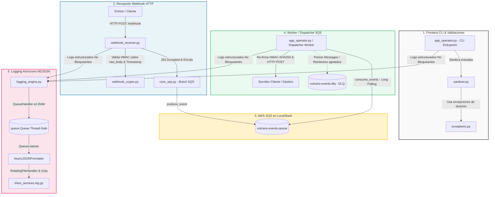

# 🚀 Proyecto Vulcano: Sistema de Procesamiento de Eventos, Webhooks HMAC y Observabilidad Asíncrona (Vulcano Pay)

Este repositorio contiene la implementación oficial de **VulcanoEventEngine**, una plataforma financiera de grado industrial diseñada para notificar eventos de pago y liquidaciones a sistemas de terceros en tiempo real mediante **Webhooks HTTP**. 

La arquitectura desacopla la recepción y la emisión de eventos utilizando **AWS SQS** emulado localmente con **LocalStack** en el puerto `4566` (`http://localhost:4566`). El sistema garantiza alta disponibilidad, mitigación de ataques de tiempo (*Timing Attacks*) y retransmisión (*Replay Attacks*), tolerancia a picos masivos de tráfico y desvío automático de mensajes venenosos a la **Dead Letter Queue (DLQ)** (`vulcano-events-dlq`).

---

## 👥 Estructura del Equipo y Distribución de Roles

| Integrante | Rol Técnico | Responsabilidades Principales |
| :--- | :--- | :--- |
| **Integrante 1** | Ingeniero de Robustez, Excepciones y Sanitización - **Rafael Adán Cruz** | Jerarquía semántica de excepciones de dominio (`exceptions.py`) y sanitización declarativa en la frontera CLI con `argparse` (`sanitizer.py`). |
| **Integrante 2** | Ingeniero de Mensajería Asíncrona SQS (Boto3) - **Mauricio Jesús Goroso Romano** | Inicialización del cliente Boto3 en LocalStack (`http://localhost:4566`), productor de eventos (`produce_event`) y consumidor con *Long Polling* (`core_sqs.py`). |
| **Integrante 3** | Ingeniero de Criptografía HMAC y Servidor Receptor - **Roberto Ezequiel Nahuel Choque Martinez** | Verificación y firma criptográfica HMAC-SHA256 sobre bytes crudos (`raw_body`) (`webhook_crypto.py`) y servidor HTTP receptor de Webhooks en `/webhook` (`webhook_receiver.py`). |
| **Integrante 4** | Ingeniero de Almacenamiento y Observabilidad - **Javier Alejandro Quiroga** | Pipeline de logging no bloqueante (`QueueHandler`/`QueueListener`), formateador NDJSON y rotación Gzip idempotente a 2 MB (`logging_engine.py`). |
| **Integrante 5** | Coordinador de Integración y CLI Engine - **Noemí Barragan** | Punto de entrada CLI con subcomandos `argparse`, worker despachador, fachada del paquete (`__init__.py`) y captura `except*` con limpieza PEP 765 (`app_operator.py`). |
| **Integrante 6** | Ingeniero de Simulación de Caos y Pruebas Forenses **Nuevo Compañero falta nombre** | Suite de inyección de caos y firmas corruptas (`test_chaos.py`) y auditoría forense automatizada de logs comprimidos `.gz` (`test_forensic_log.py`). |

---

## 📐 Diagrama de Arquitectura General



---
## 📂 Estructura de Directorios del Proyecto

```text
vulcano_engine/
├── src/
│   ├── vulcano_telemetry/
│   │   ├── __init__.py              # Fachada del paquete y definición de __all__
│   │   ├── exceptions.py            # Excepciones de dominio (VulcanoError)
│   │   ├── sanitizer.py             # Validadores declarativos de argparse
│   │   ├── core_sqs.py              # Cliente Boto3 SQS y consumidor resiliente
│   │   ├── webhook_crypto.py        # Generación y verificación HMAC-SHA256
│   │   ├── webhook_receiver.py      # Servidor HTTP receptor de Webhooks
│   │   └── logging_engine.py        # QueueHandler + QueueListener + Gzip
│   └── app_operator.py              # Orquestador CLI principal
├── tests/
│   ├── test_chaos.py                # Suite de simulación de caos
│   └── test_forensic_log.py         # Auditoría forense de logs comprimidos
├── docker-compose.yml               # Configuración de LocalStack (puerto 4566)
├── requirements.txt                 # Dependencias del proyecto
└── README.md                        # Documentación 
```
---
## 🛠️ Requisitos Previos e Instalación

### 1\. Clonar el Repositorio

```
git clone https://github.com/racoonar-Sla/vulcano_engine.git
cd vulcano_engine

```

### 2\. Crear y Activar el Entorno Virtual (`.venv`)


* **En Windows (PowerShell):**

```
python -m venv .venv
.venv\Scripts\Activate.ps1
```
* **En Linux / macOS:**

```
python3 -m venv .venv
source .venv/bin/activate

```
### 3\. Instalar Dependencias

```
pip install --upgrade pip
pip install -r requirements.txt

```

### 4\. Inicializar LocalStack con Docker Desktop

Nos aseguramos de tener **Docker Desktop** activo y ejecuta:

```
docker compose up -d

```

Verificamos la salud del servicio SQS emulado en: `http://localhost:4566/_localstack/health`

---
